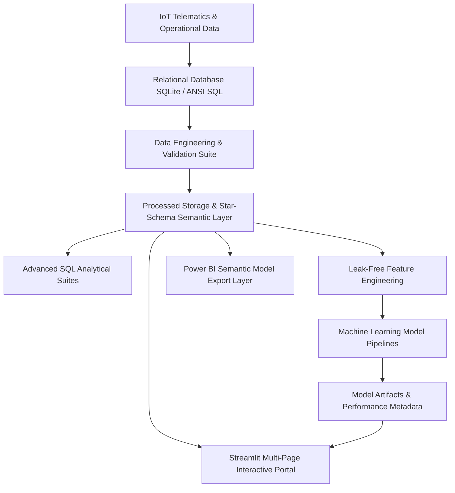

# ⚡ EV Fleet & Rider Intelligence System

[](https://www.python.org/)
[](https://sqlite.org/)
[](https://scikit-learn.org/)
[](https://streamlit.io/)
[](https://powerbi.microsoft.com/)
[](https://pytest.org/)

An industry-grade analytics, telematics, and predictive machine learning platform built from scratch for electric two- and three-wheeler logistics. The platform delivers executive intelligence across rider retention, vehicle uptime, battery degradation physics, delivery fulfillment failure diagnosis, and hardware supplier quality audit.

🔗 **Live Interactive Application:** [EV Fleet Intelligence Dashboard](https://fated-carved-puma.8501.dev.raccoonai.tech)

---

## 🏗️ System Architecture



---

## 📁 Project Directory Structure

```
/workspace/
├── app/                               # Streamlit Web Application
│   ├── streamlit_app.py               # Main landing portal & system telemetry
│   ├── pages/                         # Multi-page interactive application
│   │   ├── 1_Executive_Overview.py    # Macro KPIs, revenue, regional density
│   │   ├── 2_Rider_Analytics.py       # Onboarding funnel, cohort retention curves
│   │   ├── 3_Churn_Prediction.py      # ML Churn inference sandbox & risk queue
│   │   ├── 4_Battery_Intelligence.py  # Degradation physics & live SOH regressor
│   │   ├── 5_Delivery_Analytics.py    # Failure roots & pre-dispatch risk engine
│   │   ├── 6_Supplier_Intelligence.py # Supplier quality scorecard & warranty risk
│   │   ├── 7_Rider_Segmentation.py    # K-Means behavioral clustering personas
│   │   └── 8_Model_Performance.py     # Model cards, confusion matrices, audit
│   └── utils/
│       ├── data_loader.py             # Memory caching & dataset accessors
│       └── ui_helpers.py              # Dark theme CSS, KPI renderers, Plotly theme
├── data/
│   ├── raw/                           # Generated raw operational CSV files
│   ├── processed/                     # Transformed & enriched analytical tables
│   └── powerbi_export/                # Star-schema dimension and fact tables
├── database/
│   ├── schema.sql                     # ANSI SQL relational schema with constraints
│   ├── init_db.py                     # Schema applicator and data loader
│   └── ev_fleet.db                    # Relational SQLite database
├── docs/
│   ├── data_dictionary.md             # Complete entity-relationship documentation
│   ├── model_cards.md                 # Formal Google-standard ML model cards
│   └── powerbi_specification.md       # Star schema, DAX formulas & visuals spec
├── models_artifacts/
│   ├── churn_model.joblib             # Champion Random Forest Classifier
│   ├── battery_model.joblib           # Champion Random Forest SOH Regressor
│   ├── delivery_model.joblib          # Champion XGBoost Failure Classifier
│   ├── segmentation_model.joblib      # Champion K-Means Clustering Pipeline
│   └── model_metadata.json            # Model benchmarks, metrics, and parameters
├── notebooks/
│   └── eda_analysis.py                # Systematic EDA & publication figure generator
├── reports/
│   ├── figures/                       # Publication-grade analytical charts (PNG)
│   ├── eda_summary.md                 # Statistical findings & data hygiene report
│   ├── business_recommendations.md    # Executive operational blueprint
│   └── sql_results/                   # Exported query outputs from SQL suites
├── sql/
│   ├── 01_rider_retention_and_churn.sql
│   ├── 02_delivery_performance.sql
│   ├── 03_battery_degradation_and_swaps.sql
│   ├── 04_supplier_quality_scorecard.sql
│   └── 05_regional_fleet_utilization.sql
├── src/
│   ├── data_generator.py              # Physics-grounded synthetic telemetry generator
│   ├── analytics/
│   │   └── sql_runner.py              # SQL execution engine and benchmark runner
│   ├── etl/
│   │   ├── extract.py                 # Database extraction interface
│   │   ├── validator.py               # Data quality & referential integrity suite
│   │   ├── transform.py               # Cleaning, feature derivation, enrichment
│   │   ├── load.py                    # Persistence and Power BI layer exporter
│   │   └── pipeline.py                # Orchestrated ETL pipeline runner
│   ├── features/
│   │   └── engineering.py             # Leak-free feature matrices & temporal cuts
│   └── models/
│       ├── churn_model.py             # Churn classifier trainer
│       ├── battery_model.py           # Battery degradation regressor trainer
│       ├── delivery_model.py          # Temporal pre-dispatch classifier trainer
│       ├── segmentation_model.py      # K-Means clustering trainer
│       └── train_all.py               # Master training and evaluation orchestrator
├── tests/                             # Comprehensive Pytest unit test suite
│   ├── test_etl.py                    # ETL and transformation tests
│   ├── test_validation.py             # Data quality & edge case tests
│   ├── test_features.py               # Feature leakage & column integrity tests
│   ├── test_models.py                 # Model inference, edge cases, boundaries
│   └── test_app.py                    # Streamlit utilities and cache tests
├── requirements.txt                   # Pinned production dependencies
├── .gitignore                         # Version control ignore rules
└── .env.example                       # Environment configuration template
```

---

## ⚡ Quickstart & Reproducibility Guide

All steps can be executed sequentially from the project root:

### 1. Environment Installation
```bash
pip install -r requirements.txt
```

### 2. Generate Synthetic Dataset & Initialize Database
Generates 1,200 riders, 600 vehicles, 800 batteries, 311,000+ trips, and 358,000+ deliveries:
```bash
python3 src/data_generator.py
python3 database/init_db.py
```

### 3. Run Production ETL & Data Quality Validations
Executes 35 automated integrity checks, enriches features, and exports the Power BI star schema:
```bash
python3 src/etl/pipeline.py
```

### 4. Execute Advanced Analytical SQL Suites
Benchmarks and runs all 5 SQL scripts against SQLite:
```bash
python3 src/analytics/sql_runner.py
```

### 5. Generate Exploratory Data Analysis (EDA) & Charts
Computes statistical distributions and generates publication-grade figures in `reports/figures/`:
```bash
python3 notebooks/eda_analysis.py
```

### 6. Train & Register Machine Learning Models
Trains all 4 models with time-based splits, evaluates metrics, and generates `model_metadata.json`:
```bash
python3 src/models/train_all.py
```

### 7. Run Complete Pytest Suite
Executes all 19 unit tests across ETL, validation, feature engineering, and model inference:
```bash
pytest tests/ -v
```

### 8. Launch Streamlit Application
```bash
streamlit run app/streamlit_app.py --server.port 8501 --server.address 0.0.0.0
```
Access the dashboard locally at `http://localhost:8501` or via the live preview URL:
🔗 [EV Fleet Intelligence Dashboard](https://fated-carved-puma.8501.dev.raccoonai.tech)

---

## 🧠 Machine Learning Model Benchmarks

| Model Task | Target Variable | Architecture | Key Metric | Benchmark Comparison | Validation Strategy |
| :--- | :--- | :--- | :--- | :--- | :--- |
| **Rider Churn** | `churn_label` (Binary) | **Random Forest** | **$\text{ROC-AUC} = 0.9884$, $F1 = 0.7692$** | Outperformed Logistic Reg ($F1 = 0.6364$) | Stratified Split, 45-day forward inactivity |
| **Battery SOH** | `current_soh_pct` (Continuous) | **Random Forest Regressor** | **$\text{MAE} = 1.1205\%$, $R^2 = 0.8685$** | Outperformed XGBoost ($\text{MAE} = 1.1839\%$) | Physical telematics, 80/20 train/test |
| **Delivery Failure**| `target_failure` (Binary) | **XGBoost Classifier** | **$\text{PR-AUC} = 0.0832$, $\text{Recall} = 42.6\%$** | Outperformed Logistic Reg ($\text{PR-AUC} = 0.0764$) | **Strict Chronological Temporal Split** |
| **Segmentation** | Behavioral Clusters | **K-Means ($k=4$)** | **$\text{Silhouette} = 0.1955$, $\text{DB} = 1.5942$** | Optimal vs $k=2,3,5,6$ | StandardScaler, 9 behavioral features |

---

## 🚀 Cloud Deployment Instructions

### Option A: Streamlit Community Cloud
1. Push this repository to GitHub.
2. Log into [share.streamlit.io](https://share.streamlit.io).
3. Select your repository, branch `main`, and main file path `app/streamlit_app.py`.
4. Add environment variables from `.env.example` under **Advanced settings -> Secrets**.
5. Click **Deploy**.

### Option B: Docker / Render / AWS ECS
A standard container deployment can use the following Dockerfile:
```dockerfile
FROM python:3.11-slim
WORKDIR /workspace
COPY requirements.txt .
RUN pip install --no-cache-dir -r requirements.txt
COPY . .
EXPOSE 8501
CMD ["streamlit", "run", "app/streamlit_app.py", "--server.port=8501", "--server.address=0.0.0.0"]
```

---

## 📜 Business Recommendations Summary
1. **Dynamic Rental Floor Subsidies:** Automatically discount daily lease fees by 50% for standard riders experiencing soft demand to curb early-tenure churn.
2. **Pre-Dispatch Battery Minimums:** Mandate a dynamic SOC threshold based on route distance to eliminate mid-trip battery-depletion delivery failures.
3. **Preventive Battery Decommissioning:** Decommission packs with SOH $< 75\%$ or internal resistance $> 38\text{ m}\Omega$ and transition to stationary buffer storage (ESS).
4. **Supplier Warranty Enforcement:** Enforce liquidated warranty clawbacks against Tier-3 suppliers with lot defect rates exceeding contract SLAs.
5. **Rider Persona Targeting:** Rebalance vehicle allocation and surge incentives around the 4 identified behavioral archetypes (Peak Hustlers, Steady Full-Timers, Casual Flexible, At-Risk Low Earners).
